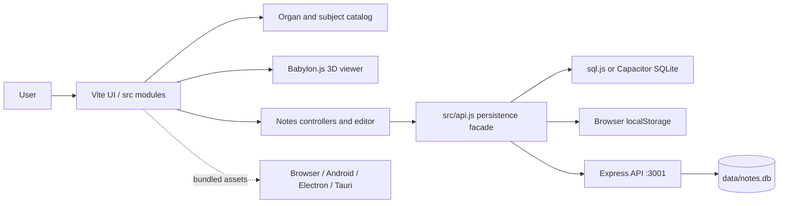
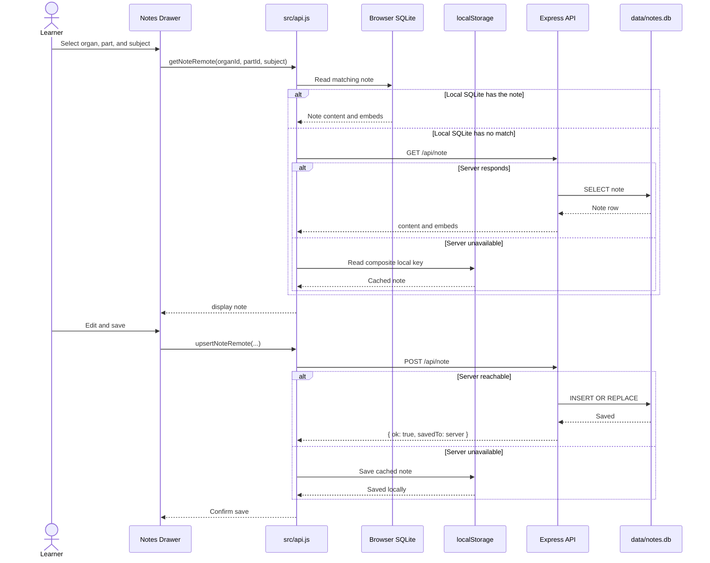
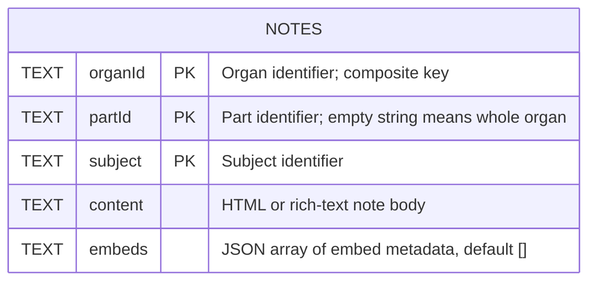

# Brian Meds Documentation

## 1. Overview

Brian Meds is a cross-platform medical learning and study application that brings together subject-based notes, organ-system exploration, and an interactive 3D learning experience when models are available. Anatomy is a core part of the app, alongside related medical subjects such as biochemistry, physiology, parasitology, and microbiology. The project combines a Vite frontend, a Babylon.js 3D viewer, an Express API for note storage, and desktop packaging through Tauri and Electron.

The interface is organized around:

- Organ systems such as cardiovascular, respiratory, digestive, nervous, and urinary
- Subject filters like Anatomy, Biochemistry, Physiology, Parasitology, and Microbiology
- Interactive organ selection from the sidebar
- Notes drawer for reading and editing notes
- SQLite-backed note persistence with local fallback and synchronization support
- Desktop packaging through Tauri and Electron
- Android packaging through Capacitor

---

## 2. Project Goals

This application supports medical education across anatomy and related subject areas. Learners can:

- browse organ systems visually
- inspect organ-specific details
- access notes by subject area
- save notes locally or server-side
- export/import note databases
- use the same project in both browser and desktop environments

---

## 3. Technology Stack

### Frontend

- Vite
- JavaScript / ES modules
- HTML and CSS
- Babylon.js for 3D model rendering

### Backend

- Node.js
- Express.js
- SQLite via sqlite3
- CORS and multipart upload support via multer

### Native wrappers and packaging

- Capacitor 8 for Android
- Electron for desktop distribution
- Tauri 2 with a Rust shell for native desktop builds

### Key dependencies

From [package.json](package.json):

- @babylonjs/core
- @babylonjs/loaders
- express
- sqlite3
- sql.js
- multer
- cors
- @capacitor/core and @capacitor-community/sqlite
- @tauri-apps/cli
- electron
- piper-tts-web
- vite
- concurrently

---

## 4. High-Level Architecture

BRIAN NOTES is a layered, single-page application delivered through several runtimes:

1. **Presentation and study experience** — [index.html](index.html) and the modules under [src/](src/) render subjects, organs, the Babylon.js viewer, notes drawer, editor, media embeds, theme controls, quizzes, and offline speech.
2. **Application orchestration** — [src/main.js](src/main.js) wires the medical content catalog, viewer lifecycle, UI state, drawers, and controllers together.
3. **Persistence adapters** — [src/api.js](src/api.js) coordinates server storage, [src/db.js](src/db.js) provides browser-native SQLite storage, and `localStorage` is the final offline fallback.
4. **Local service and media API** — [server.js](server.js) exposes note, database import/export, and upload endpoints, backed by [data/notes.db](data/notes.db).
5. **Native shells** — Vite output can run in a browser, Android through Capacitor, Windows/macOS/Linux through Electron, or Windows through Tauri.



### Runtime sequence: opening and saving a note



A browser or native client normally tries a local SQLite adapter first, then the Express API, with browser `localStorage` as the offline cache. Android uses Capacitor SQLite where available; browser builds use sql.js and persist the database encoded in `localStorage`.

### Android packaging

The project includes a Capacitor Android app. Install Android Studio, Android SDK Platform 36, Android SDK Build Tools, and a supported JDK (17-25). From the project root on Windows:

```powershell
npm install
npm run android:sync
```

- `npm run android:sync` runs the production build and copies its output into the Android project.
- `npm run android:debug` builds and synchronizes the app, then creates a debug APK.
- `npm run android:apk` creates a release APK without invoking the signing-key helper.
- `npm run android:aab` creates a release Android App Bundle.
- `npm run android:release` runs the signing helper, which builds/synchronizes the web app and creates both APK and AAB outputs.

The release helper creates or uses a local signing configuration and writes:

- `android/app/build/outputs/apk/release/app-release.apk`
- `android/app/build/outputs/bundle/release/app-release.aab`

The helper also creates `android/key.properties` and `android/app/release-key.jks` when they are not present. Keep the keystore and its passwords private and replace this development signing setup before publishing.

To continue in Android Studio:

1. Open the `android` folder, not the repository root.
2. Let Gradle finish syncing and select the `app` run configuration.
3. Set Gradle JDK to Android Studio's bundled JDK in **Settings > Build, Execution, Deployment > Build Tools > Gradle**.
4. Use **Build > Generate Signed Bundle / APK** for a store-distributable build, or press Run for local development.

---

## 5. Folder Structure

```text
BRIAN/
├─ data/                     # SQLite DB storage and persistent app data
├─ models/                   # 3D model files and asset folders
├─ public/                   # Static public assets
├─ uploads/                  # Temporary upload directory for DB imports
├─ src/                      # Frontend source files
│  ├─ api.js                 # Remote/local note sync helpers
│  ├─ db.js                 # SQLite-related logic or data helpers
│  ├─ main.js               # Main UI logic and Babylon scene setup
│  ├─ organs.js             # Organ/system data catalog
│  ├─ style.css             # Frontend styling
│  └─ assets/               # UI assets
├─ src-tauri/                # Tauri app configuration and Rust shell
│  ├─ src/                  # Rust app code
│  ├─ capabilities/         # Tauri capabilities config
│  ├─ icons/                # App icon assets
│  ├─ Cargo.toml            # Rust package manifest
│  ├─ build.rs              # Rust build script
│  └─ tauri.conf.json       # Desktop app settings
├─ index.html                # App entry page
├─ server.js                 # Express note API server
├─ style.css                 # App-level CSS
├─ vite.config.js            # Vite config
├─ package.json              # Scripts and dependencies
├─ package-lock.json         # Lock file
├─ README.md                 # Project documentation
└─ ...
```

---

## 6. Application Workflow

### Web app flow

1. The page loads in the browser.
2. The sidebar renders organ systems and subject buttons.
3. The user selects a subject and organ.
4. Babylon.js loads a 3D model if the organ has a valid model path and file.
5. The notes drawer opens for the selected organ or part.
6. Notes are fetched from the backend or local storage.
7. The user can edit notes and save them.
8. Notes can be synchronized back to the server.

### Notes flow

- Each note is stored by:
  - organId
  - partId
  - subject
  - content
- This makes it possible to keep separate note records for anatomy, physiology, etc., for the same organ.

---

## 7. Core Files

### [index.html](index.html)

The page layout includes:

- sidebar with subjects and organs
- main viewer canvas
- 3D model placeholder
- notes drawer UI
- note-related controls

### [src/main.js](src/main.js)

This is the main frontend runtime. It handles:

- scene creation and camera setup
- organ selection and rendering
- model loading
- subject selection state
- notes drawer behavior
- modal or drawer editing flow
- UI interactions for notes viewing and synchronization

### [src/organs.js](src/organs.js)

This file defines the anatomy dataset. It contains:

- system definitions
- organ metadata
- model file references
- notes templates and content blocks
- part metadata for substructures like ventricles and lobes

### [src/api.js](src/api.js)

This file centralizes API calls and local fallback logic. It provides functions like:

- getNoteRemote
- upsertNoteRemote
- listNotesRemote
- syncLocalToServer
- exportDbUrl
- importDbFile

### [server.js](server.js)

The Express server provides the backend API. It:

- opens and initializes the SQLite database
- exposes endpoints for reading and writing notes
- supports database export
- supports database import via multipart upload
- serves static files for preview use

---

## Components

- **Main (app entry):** App bootstrap, Babylon scene and camera setup, organ selection, model loading, and UI wiring — see [src/main.js](src/main.js#L1).
- **Data catalog (`SYSTEMS`):** Organ/system dataset, model metadata, notes templates, and part definitions — see [src/organs.js](src/organs.js#L1).
- **API layer:** Remote and fallback note storage, sync, import/export helpers (`getNoteRemote`, `upsertNoteRemote`, `syncLocalToServer`) — see [src/api.js](src/api.js#L1).
- **Storage (DB):** SQLite initialization and query layer with native (Capacitor) and web sql.js fallbacks (`initDB`, `getNote`, `upsertNote`) — see [src/db.js](src/db.js#L1).
- **Notes formatting:** Sanitization and conversion of plain/text or HTML notes, media path resolution, and safe embed handling (`formatNoteContent`, `sanitizeEmbedHtml`) — see [src/notes.js](src/notes.js#L1).
- **Drawer controller:** Notes drawer behavior, edit/save state, embed metadata rendering, and accessibility handling (`createDrawerController`) — see [src/drawer.js](src/drawer.js#L1).
- **Embed modal:** Insert/edit trusted iframe embeds, build embed tiles, drag-and-drop ordering, and focus trapping (`createEmbedController`) — see [src/embed-modal.js](src/embed-modal.js#L1).
- **Media helper:** File reading and upload fallback; inserts image/video markup into editor (`createMediaController`) — see [src/media.js](src/media.js#L1).
- **UI helpers:** Theme toggling and sidebar state persistence (`createUiController`) — see [src/ui.js](src/ui.js#L1).
- **Utilities / examples:** Small helper like `setupCounter` for quick UI demos — see [src/counter.js](src/counter.js#L1).
- **Styles & assets:** Core styles live in [src/style.css](src/style.css#L1) and project-level [style.css](style.css), with static assets under `src/assets/`.

This section provides a quick mapping from runtime responsibilities to source files so contributors can find the code implementing each feature.

## 8. API Reference

The backend server runs on port 3001 by default.

### Base URL

```text
http://localhost:3001
```

### GET /api/note

Gets a single note.

Query parameters:

- organId
- partId
- subject

Example:

```http
GET /api/note?organId=heart&partId=left-ventricle&subject=anatomy
```

Response:

```json
{
  "content": "<p>Left ventricle: ...</p>",
  "embeds": []
}
```

### POST /api/note

Creates or updates a note.

Body:

```json
{
  "organId": "heart",
  "partId": "left-ventricle",
  "subject": "anatomy",
  "content": "<p>Example note content</p>",
  "embeds": []
}
```

Response:

```json
{
  "ok": true
}
```

### GET /api/notes

Returns all notes in the database.

Response:

```json
[
  {
    "organId": "heart",
    "partId": "left-ventricle",
    "subject": "anatomy",
    "content": "<p>Example note</p>",
    "embeds": []
  }
]
```

### GET /api/export

Downloads the current SQLite database as notes.db.

### POST /api/import

Uploads a database file for replacement.

Expected multipart field:

- dbfile

---

## 9. Database Design

The persisted application database currently contains one logical entity: a subject-specific note. The same schema is maintained by the Express server, Capacitor SQLite, and sql.js implementations.

### Entity relationship diagram



The three-part composite key uniquely identifies a note across organ, anatomical part, subject, and fallback content location. There are no foreign-key tables for organs or subjects: [src/organs.js](src/organs.js) and the frontend subject catalog are the source of truth, while SQLite stores only user-created note content.

### Physical schema

```sql
CREATE TABLE IF NOT EXISTS notes (
  organId TEXT,
  partId TEXT DEFAULT '',
  subject TEXT,
  content TEXT,
  embeds TEXT DEFAULT '[]',
  PRIMARY KEY (organId, partId, subject)
);
```

Column details:

| Column | Meaning |
|---|---|
| `organId` | Stable identifier for an organ or top-level study item, such as `heart`. |
| `partId` | Stable substructure identifier. An empty string represents the whole organ. |
| `subject` | Subject namespace, such as Anatomy, Physiology, or Biochemistry. |
| `content` | Note body stored as HTML/rich text after editor sanitization. |
| `embeds` | JSON-serialized array containing embedded media or iframe metadata; legacy databases default it to `[]`. |

### Storage copies and synchronization

- **Server copy:** `data/notes.db`, managed by [server.js](server.js).
- **Web copy:** the sql.js database is serialized to Base64 and persisted under `brian_sqlite_db_v1` in `localStorage`.
- **Android copy:** Capacitor SQLite database `notes_db`, with schema migrations handled in [src/db.js](src/db.js).
- **Offline cache:** browser fallback records are stored under `brian_notes_local_v1`, keyed by `organId||partId||subject`.

The server's `GET /api/export` and `POST /api/import` routes transfer a complete SQLite database, while `syncLocalToServer()` migrates offline cache entries into the server database.

---

## 10. Local Storage Fallback

If the server is unavailable, the client uses localStorage. The logic in [src/api.js](src/api.js) stores notes using a composite key:

```text
organId||partId||subject
```

The application supports syncing saved local notes back to the server using:

```js
syncLocalToServer();
```

This is especially useful when running the app without a stable backend service.

---

## 11. 3D Model Integration

The app uses Babylon.js to load organ models.

The viewer logic in [src/main.js](src/main.js) does the following:

- creates an engine and scene
- sets up an ArcRotateCamera
- adds a hemispheric light
- loads models with SceneLoader.AppendAsync
- disposes the previous scene before loading a new model

Model metadata is declared in [src/organs.js](src/organs.js), where each organ may define:

- modelPath
- modelFile
- notes
- parts

Some organs do not currently have valid model files, which triggers the placeholder message in the viewer.

---

## 12. Subject Areas

The application includes the following study categories:

- Anatomy
- Biochemistry
- Physiology
- Parasitology
- Microbiology

These subject filters drive the note content displayed for each organ and part.

---

## 13. Running the Project

### Install dependencies

```bash
npm install
```

### Start the web app with backend and Vite

```bash
npm run dev
```

This script runs:

- Express server on port 3001
- Vite frontend development server

### Start only the backend API

```bash
npm run start:server
```

### Start backend in development mode

```bash
npm run dev:server
```

### Build the frontend for production

```bash
npm run build
```

### Preview the production build

```bash
npm run preview
```

---

## 14. Desktop App (Tauri)

The project also supports packaging as a desktop application.

### Run in desktop development mode

```bash
npm run dev:desktop
```

This uses the Tauri CLI and launches the native desktop app.

### Build desktop installer/bundle

```bash
npm run build:desktop
```

Desktop configuration is defined in [src-tauri/tauri.conf.json](src-tauri/tauri.conf.json).

The app metadata includes:

- product name: BRIAN-NOTES
- application identifier: com.brian.notes
- window width/height
- bundle settings for desktop packaging

The Tauri production build uses `npm run build:tauri` to keep the large 3D models out of the embedded frontend bundle. It packages `public/models/` as app resources instead; the desktop viewer resolves model files from that resource directory. Web and Android builds continue to use the regular Vite public-asset paths.

### Offline Piper voice

The notes reader includes Piper's LJSpeech medium voice as an optional offline neural voice. Its ONNX model and metadata are bundled under `public/piper/models/`; Piper's ONNX and phonemizer WebAssembly assets are copied into each Vite build. Speech synthesis runs locally, with no voice download or server request at playback time. Existing browser-provided voices remain available. The bundled voice model is about 63.5 MB; its upstream [model card](https://huggingface.co/rhasspy/piper-voices/tree/main/en/en_US/ljspeech/medium) identifies the LJSpeech training data as public domain.

### Windows installer

The NSIS installer displays [LICENSE.txt](LICENSE.txt) before installation. Its installer and uninstaller icons use `src-tauri/icons/icon.ico`, generated from `src-tauri/icons/254.jpg`; the welcome/sidebar and header artwork are generated from the same source.

If the 254 artwork changes, regenerate the application and installer icons before building:

```powershell
npm run generate:icons
npm run build:desktop
```

The generated Windows installers are:

- NSIS setup: `src-tauri/target/release/bundle/nsis/BRIAN-NOTES_0.1.0_x64-setup.exe`
- MSI: `src-tauri/target/release/bundle/msi/BRIAN-NOTES_0.1.0_x64_en-US.msi`

Use the NSIS setup when the user must review and accept the terms before installing. The current MSI UI skips the license dialog.

---

## 15. Development Notes

### Frontend behavior

The app currently relies on a dynamic data structure where organ definitions and their notes are embedded in [src/organs.js](src/organs.js). This makes it easy to add new organs, systems, and note content without changing the UI logic heavily.

### Data extensibility

To extend the app:

1. Add a new system in [src/organs.js](src/organs.js)
2. Add an organ entry with metadata and notes
3. Optionally add subparts and their own note content
4. Add a model path/file if a 3D preview should be available

### Potential enhancements

The current codebase is a solid base for future improvements such as:

- search and filtering across organs
- richer note editing tools
- image attachments
- export to CSV/JSON
- user accounts
- cloud sync
- full interactive anatomical labeling

---

## 16. Common Tasks

### Add a new organ

Edit [src/organs.js](src/organs.js) and add a new object under a system's organs array.

Example structure:

```js
{
  id: "kidney",
  name: "Kidney",
  modelPath: null,
  modelFile: null,
  notes: {
    anatomy: "<p>...</p>",
    physiology: "<p>...</p>"
  }
}
```

### Add a note for a specific organ/part

Use the note data under the chosen organ or part and set the appropriate subject key.

### Export notes

Direct the browser to the server export endpoint or use the app's UI if present.

### Import notes

Use the import endpoint and upload a notes database file.

---

## 17. Known Observations

From the current code and structure:

- Some models are present while others are intentionally unset with null paths.
- The app supports both backend persistence and local fallback.
- The project is meant to support a range of medical learning content and subject-specific study notes.
- The frontend UI is modular and easy to extend for additional anatomy systems or media.

---

## 18. Build and Deployment Considerations

### Local development

Use the Vite + Express combination for a quick local workflow.

### Production deployment

For web deployment:

- build the frontend with `npm run build`
- serve the generated bundle using an appropriate hosting service
- keep the Express API available or replace it with a production database-backed service

For desktop deployment:

- use Tauri packaging commands
- ensure the required app icons and platform resources are present

---

## 19. Troubleshooting

### Server not responding

Check whether the backend is running on port 3001.

```bash
npm run start:server
```

### Model not rendering

Verify the organ's model metadata in `src/data/systems/` and confirm the referenced file exists under `public/models/`. For Tauri, rebuild and install the latest desktop package so the updated model resources are included.

### Notes not saving

Check whether the backend is reachable and whether the browser has localStorage available.

### Tauri build issues

Confirm dependencies are installed and Rust toolchain is available for the Tauri environment.

---

## 20. Summary

Brian Meds is a medical education application combining interactive 3D visualization, structured subject-specific notes, and cross-platform access. It supports anatomy and other medical study areas, helping learners explore organ systems, inspect available 3D models, and keep study material organized.

The project is practical, modular, and well-suited for future expansion into richer educational content and data management features.

---

## 21. Quick Start

```bash
npm install
npm run dev
```

Then open the app in the browser to explore medical subjects, organ systems, and available 3D models.

For desktop use:

```bash
npm run dev:desktop

npm run build:desktop
```

---

## 22. Notes for Maintainers

- Prefer adding anatomy and organ-system content in [src/organs.js](src/organs.js), and related medical subject content in `src/data/systems/`
- Keep API compatibility consistent in [src/api.js](src/api.js)
- Validate note structure before adding new subject labels
- Rebuild the app after major data or UI changes

This documentation reflects the current implementation as seen in the repository structure and source files.

```bash
npm run build:electron
```
